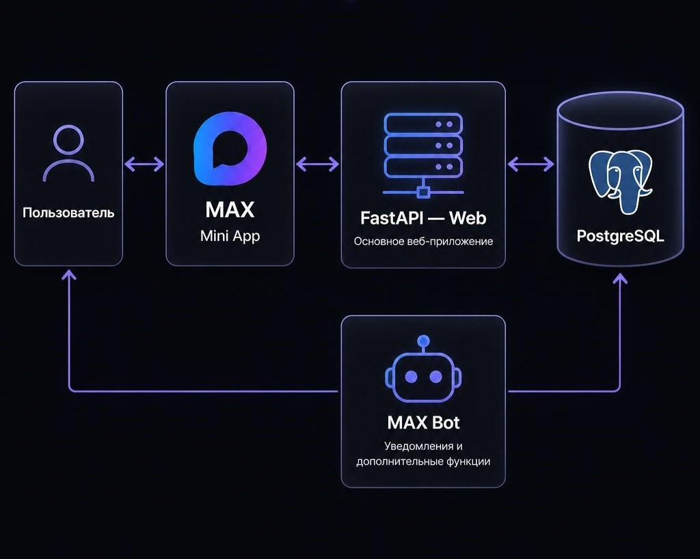

# ВЕКТОР — Найди проект. Найди команду.


**ВЕКТОР (VECTOR)** — платформа для поиска образовательных проектов и формирования команд. Сервис помогает школьникам находить интересные идеи, подбирать подходящие роли, искать единомышленников и объединяться для совместной деятельности.

Главная цель проекта — сделать поиск проектов и участников команды доступнее, объединив эти возможности в одном пространстве.

---

## О проекте

Не каждый школьник уже имеет команду или знает, где её найти. Поиск участников для совместной работы часто происходит через знакомых, чаты, кружки и отдельные сообщества. Информация оказывается разбросана по разным местам, а поиск людей с определёнными навыками может занимать много времени.

ВЕКТОР предлагает альтернативу: единое пространство, в котором авторы могут публиковать свои идеи и искать участников, а школьники — находить проекты по интересам и выбирать подходящие роли.

### Для кого создан ВЕКТОР?

- **Участники проектов** — школьники, которые хотят получить практический опыт, попробовать себя в новых направлениях и присоединиться к интересной команде.
- **Авторы проектов** — пользователи, которым нужны участники с определёнными навыками для реализации собственных идей.

Основная целевая аудитория — школьники от 12 до 18 лет.

## Возможности платформы

### 1. Поиск проектов и идей

Пользователи могут просматривать опубликованные идеи, знакомиться с их описанием и выбирать подходящие проекты.

Возможности:
- Просмотр опубликованных проектов.
- Поиск по названию и содержанию.
- Фильтрация по тематическим категориям.
- Просмотр подробной информации об идее.
- Просмотр необходимых ролей и требований к участникам.
- Просмотр количества откликов.

Доступные категории:
- Технологии.
- Наука.
- Бизнес.
- Творчество.
- Образование.
- Социальные проекты.
- Развлечения.
- Другое.

### 2. Создание и управление идеями

Любой авторизованный пользователь может опубликовать собственную идею и начать собирать команду.

При создании проекта можно указать:
- Название.
- Краткое описание.
- Подробное описание.
- Категорию.
- Необходимые роли и навыки.
- Сроки реализации.
- Дополнительные ссылки.
- Ссылку на чат проекта в MAX.

Автор может редактировать и удалять свои публикации, а также управлять поступающими откликами.

### 3. Отклики и формирование команды

Школьник может выбрать интересующий проект, определиться с подходящей ролью и отправить заявку автору.

Автор проекта получает информацию об откликах и может:
- Просматривать заявки.
- Знакомиться с профилями кандидатов.
- Принимать подходящих участников.
- Отклонять неподходящие заявки.

После принятия участника он получает возможность перейти в чат проекта в MAX.

Таким образом, ВЕКТОР объединяет поиск проекта, выбор роли, подачу заявки и формирование команды в единый процесс.

### 4. Профили пользователей

У каждого пользователя есть собственный профиль, который помогает другим участникам познакомиться с его интересами и возможностями.

В профиле можно указать:
- Имя.
- Фотографию.
- Краткую информацию о себе.
- Навыки.
- Ссылки на портфолио и другие ресурсы.

Профили помогают авторам проектов оценивать отклики и находить участников с подходящими навыками.

### 5. Мероприятия

ВЕКТОР предоставляет отдельный раздел для публикации образовательных мероприятий.

Организаторы могут:
- Создавать мероприятия.
- Добавлять название и описание.
- Указывать регион.
- Загружать изображение.
- Размещать ссылки на внешние ресурсы.
- Редактировать и удалять свои публикации.

Пользователи могут просматривать мероприятия и переходить по ссылкам организаторов для получения дополнительной информации и участия.

**Важно:** регистрация на мероприятия осуществляется на внешних площадках организаторов. ВЕКТОР служит площадкой для публикации и поиска мероприятий, а не заменяет системы регистрации организаторов.

### 6. Настройки и оформление

В настройках доступен выбор темы оформления интерфейса. Пользователь может переключаться между светлой и тёмной темами.

### 7. Авторизация через MAX

ВЕКТОР реализован в формате MAX Mini App.

Авторизация выполняется через MAX:
- Пользователь открывает Mini App.
- Приложение получает данные авторизации MAX.
- Сервер проверяет подлинность полученных данных.
- При успешной проверке пользователь авторизуется.
- При первом входе создаётся профиль пользователя.

Это позволяет использовать учётную запись MAX без отдельной регистрации с паролем внутри ВЕКТОРА.

## MAX-бот

В проекте предусмотрен отдельный MAX-бот, который дополняет возможности Mini App.

Доступные команды:

| Команда | Назначение |
|---|---|
| `/start` | Приветствие и открытие ВЕКТОРА |
| `/about` | Информация о проекте |
| `/send_org` | Подача заявки на получение роли организатора |
| `/my_status` | Просмотр своей роли и статуса заявки |
| `/report` | Отправка обращения администрации |
| `/cancel` | Отмена текущего действия |

### Уведомления

Бот связан с основной базой данных и получает уведомления из общей очереди.

Пользователи могут получать сообщения о событиях, связанных с их участием в проектах, например о решениях авторов по откликам.

### Организаторы и администрация

Пользователь может отправить заявку на получение роли организатора через `/send_org`.

Администрация рассматривает заявку и принимает решение. После этого пользователь получает уведомление о результате.

## Модерация контента

Для повышения качества пользовательского контента в ВЕКТОР предусмотрена автоматическая проверка текста.

При проверке используются:
- Библиотека BadWords.
- Собственный словарь нежелательной лексики на русском и английском языках.
- Нормализация текста и обработка некоторых вариантов написания.

Проверка применяется к публикациям идей, откликам и редактируемым данным профиля.

Если текст не проходит проверку, публикация отклоняется, а пользователь получает уведомление.

## Технологический стек

Проект построен на Python и использует асинхронную архитектуру.

| Технология | Назначение |
|---|---|
| Python 3.13+ | Основной язык программирования |
| FastAPI | Серверная часть и обработка HTTP-запросов |
| Jinja2 | Серверная генерация HTML-страниц |
| HTML5 | Структура интерфейса |
| CSS3 | Оформление интерфейса |
| JavaScript | Клиентская логика и взаимодействие с MAX Mini App |
| PostgreSQL | Хранение данных |
| SQLAlchemy | Работа с базой данных |
| asyncpg | Асинхронное подключение к PostgreSQL |
| maxapi | Интеграция с MAX и работа бота |
| Docker | Контейнеризация приложения |
| Docker Compose | Управление сервисами проекта |
| Uvicorn | ASGI-сервер |

## Архитектура проекта

ВЕКТОР состоит из нескольких взаимодействующих компонентов.



### Основные сервисы

**Web (FastAPI)**

Отвечает за работу Mini App, авторизацию, обработку запросов, управление идеями, откликами, профилями и мероприятиями.

**MAX Bot**

Работает отдельно от веб-приложения. Обрабатывает команды, заявки на роль организатора, обращения администрации и отправляет уведомления.

**PostgreSQL**

Единая база данных, используемая веб-приложением и ботом. Хранит пользователей, идеи, отклики, мероприятия и уведомления.

**DB Init**

Одноразовый сервис для первоначального создания таблиц базы данных.

### Как взаимодействуют компоненты?

Веб-приложение и MAX-бот используют общую базу данных. Благодаря этому они могут обмениваться информацией без прямой зависимости друг от друга.

Например, когда автор принимает отклик на свою идею, веб-приложение создаёт уведомление в базе данных. Бот получает его из очереди и отправляет соответствующее сообщение пользователю в MAX.

## Структура проекта

```text
VECTOR/
│
├── app/
│   ├── api/
│   │   └── routers/          # Маршруты FastAPI
│   │       ├── auth.py       # Авторизация
│   │       ├── home.py       # Главная страница и поиск
│   │       ├── ideas.py      # Работа с идеями и откликами
│   │       ├── events.py     # Работа с мероприятиями
│   │       ├── profile.py    # Профили пользователей
│   │       └── settings.py   # Настройки
│   │
│   ├── db/
│   │   ├── create_db.py      # Инициализация базы данных
│   │   ├── crud.py           # Операции с данными
│   │   ├── database.py       # Подключение к PostgreSQL
│   │   └── models.py         # Модели базы данных
│   │
│   ├── max_api/
│   │   └── max_bot.py        # MAX-бот
│   │
│   ├── moderation/
│   │   ├── guard.py          # Проверка публикаций
│   │   └── moderation.py     # Механизм модерации
│   │
│   └── constants.py          # Константы проекта
│
├── auth/
│   ├── auth_init.py          # Проверка данных авторизации MAX
│   └── auth_middleware.py    # Middleware авторизации
│
├── core/
│   ├── banned_words/
│   │   └── ru_en.txt         # Словарь нежелательной лексики
│   ├── config.py             # Конфигурация
│   └── templates.py          # Настройка шаблонов
│
├── frontend/
│   ├── static/
│   │   ├── img/              # Изображения и графические ресурсы
│   │   ├── auth.js           # Клиентская авторизация
│   │   ├── share.js          # Поделиться идеей
│   │   ├── startapp.js       # Обработка запуска Mini App
│   │   ├── theme.js          # Управление темой
│   │   ├── categories.js     # Категории
│   │   └── style.css         # Стили
│   │
│   └── templates/            # HTML-шаблоны Jinja2
│
├── main.py                   # Точка входа FastAPI
├── Dockerfile                # Сборка Docker-образа
├── compose.yaml              # Конфигурация Docker Compose
├── .dockerignore             # Исключения для Docker
├── .env.example              # Пример переменных окружения
├── pyproject.toml            # Зависимости и настройки Python
└── uv.lock                   # Зафиксированные версии зависимостей
```

## Установка и запуск

Для запуска проекта локально потребуется:

- Git.
- Docker.
- Docker Compose.

### 1. Клонирование репозитория

```bash
git clone https://github.com/IBcoder2311/VECTOR.git
cd VECTOR
```

### 2. Настройка переменных окружения

Создайте файл `core/.env` на основе шаблона `.env.example`.

**Windows PowerShell:**

```powershell
Copy-Item .env.example core/.env
```

**Linux:**

```bash
cp .env.example core/.env
```

Откройте `core/.env` и заполните необходимые параметры:

| Переменная | Назначение |
|---|---|
| `DB_USER` | Пользователь PostgreSQL |
| `DB_PASSWORD` | Пароль PostgreSQL |
| `DB_NAME` | Название базы данных |
| `DB_HOST` | Адрес PostgreSQL внутри Docker-сети |
| `DB_PORT` | Порт PostgreSQL |
| `MAX_BOT_TOKEN` | Токен MAX-бота |
| `SESSION_SECRET` | Секретный ключ сессий |
| `ADMIN_MAX_IDS` | MAX ID администраторов через запятую |

Пример:

```env
DB_USER=vector
DB_PASSWORD=your_secure_password
DB_NAME=vector
DB_HOST=postgres
DB_PORT=5432

MAX_BOT_TOKEN=your_max_bot_token

SESSION_SECRET=your_secret_key

ADMIN_MAX_IDS=123456789,987654321
```

**Важно:**
- Используйте собственный токен MAX-бота.
- Установите надёжный пароль базы данных.
- Сгенерируйте уникальный `SESSION_SECRET`.
- В `ADMIN_MAX_IDS` указывайте реальные MAX ID администраторов.
- Не публикуйте файл `core/.env` и не добавляйте его в Git.

### 3. Запуск через Docker Compose

Выполните команду:

```bash
docker compose --env-file core/.env up -d --build
```

Docker автоматически:
1. Соберёт образ приложения.
2. Запустит PostgreSQL.
3. Дождётся готовности базы данных.
4. Создаст необходимые таблицы.
5. Запустит FastAPI.
6. Запустит MAX-бота.

### 4. Проверка состояния контейнеров

```bash
docker compose --env-file core/.env ps
```

Просмотр логов:

```bash
docker compose --env-file core/.env logs -f
```

Просмотр логов отдельного сервиса:

```bash
docker compose --env-file core/.env logs -f web
```

```bash
docker compose --env-file core/.env logs -f bot
```

### 5. Остановка проекта

```bash
docker compose --env-file core/.env down
```

Эта команда останавливает и удаляет контейнеры, но сохраняет данные в Docker volumes.

**Внимание:** команда `docker compose down -v` дополнительно удаляет volumes, включая данные PostgreSQL и загруженные изображения. Используйте её только тогда, когда действительно хотите удалить эти данные.

### Особенности подключения MAX Mini App

ВЕКТОР предназначен для работы внутри MAX Mini App.

Для полноценного использования необходимо настроить Mini App в MAX и указать доступный HTTPS-адрес приложения.

В текущей конфигурации Docker веб-приложение публикуется на локальном адресе `127.0.0.1:8000`. Для доступа извне потребуется HTTPS-туннель или настроенный сервер с обратным прокси.

---

## Развитие проекта

ВЕКТОР может развиваться в нескольких направлениях:

- Улучшение поиска и рекомендаций проектов.
- Расширение фильтрации по навыкам и ролям.
- Развитие системы мероприятий.
- Дополнительные инструменты для организаторов.
- Расширение возможностей взаимодействия участников.
- Масштабирование на новые образовательные сообщества и регионы.

Один из важных показателей эффективности проекта — время от публикации идеи до формирования команды.

---

**ВЕКТОР — найди своё место в проекте.**
